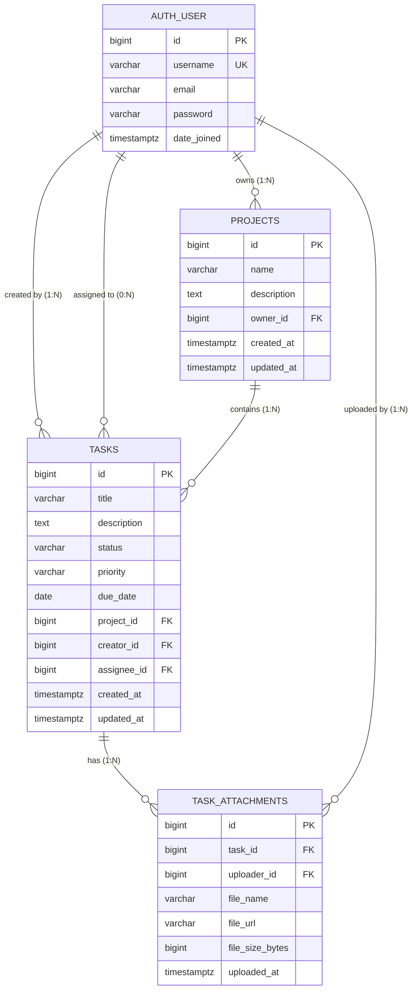

# Task Manager Relational Schema Design (PostgreSQL)

> **Curriculum Module**: Phase 1 (Days 3–6) — PostgreSQL Relational Modeling, 3NF Normalization, SQL & Indexing  
> **Core Concepts Covered in this Document**:
> 1. **Relational Database Modeling**: Entities, Attributes, and Relationships (One-to-Many, Many-to-One)
> 2. **Database Normalization (1NF → 3NF)**: Eliminating redundancy, update anomalies, and transitive dependencies
> 3. **Primary Key Strategy**: Auto-incrementing 64-bit integers (`BigAutoField`) vs. `UUID`
> 4. **Foreign Key Integrity & Deletion Rules**: `ON DELETE CASCADE`, `ON DELETE PROTECT`, `ON DELETE SET NULL`
> 5. **PostgreSQL Column Types**: `VARCHAR`, `TEXT`, `TIMESTAMPTZ`, `DATE`, `BIGINT`, `BOOLEAN`
> 6. **Database Constraints**: `NOT NULL`, `UNIQUE`, `CHECK`, and `FOREIGN KEY` constraints
> 7. **Indexing Strategy**: B-Tree indexes, Composite indexes, and Query optimization targets

---

## 1. Entity-Relationship (ER) Diagram

---

## 2. Table Specifications & Constraints

### 2.1 `projects` Table
Represents a project workspace owned by a user.

| Column Name | PostgreSQL Data Type | Modifiers / Constraints | Description |
| :--- | :--- | :--- | :--- |
| `id` | `BIGSERIAL` / `BIGINT` | `PRIMARY KEY GENERATED ALWAYS AS IDENTITY` | Unique project identifier |
| `name` | `VARCHAR(150)` | `NOT NULL` | Project title |
| `description` | `TEXT` | `NOT NULL DEFAULT ''` | Detailed project scope |
| `owner_id` | `BIGINT` | `NOT NULL REFERENCES auth_user(id) ON DELETE CASCADE` | User who created/owns the project |
| `created_at` | `TIMESTAMPTZ` | `NOT NULL DEFAULT CURRENT_TIMESTAMP` | Creation timestamp with timezone |
| `updated_at` | `TIMESTAMPTZ` | `NOT NULL DEFAULT CURRENT_TIMESTAMP` | Last updated timestamp |

- **Table Constraints**:
  - `CONSTRAINT uq_project_owner_name UNIQUE (owner_id, name)`: A user cannot create two projects with the exact same name.

---

### 2.2 `tasks` Table
Represents an individual unit of work within a project.

| Column Name | PostgreSQL Data Type | Modifiers / Constraints | Description |
| :--- | :--- | :--- | :--- |
| `id` | `BIGSERIAL` / `BIGINT` | `PRIMARY KEY GENERATED ALWAYS AS IDENTITY` | Unique task identifier |
| `title` | `VARCHAR(255)` | `NOT NULL` | Short summary of task |
| `description` | `TEXT` | `NOT NULL DEFAULT ''` | Full task details and requirements |
| `status` | `VARCHAR(20)` | `NOT NULL DEFAULT 'TODO'` | Enum: `TODO`, `IN_PROGRESS`, `BLOCKED`, `COMPLETED` |
| `priority` | `VARCHAR(20)` | `NOT NULL DEFAULT 'MEDIUM'` | Enum: `LOW`, `MEDIUM`, `HIGH`, `URGENT` |
| `due_date` | `DATE` | `NULL` | Optional task target completion date |
| `project_id` | `BIGINT` | `NOT NULL REFERENCES projects(id) ON DELETE CASCADE` | Parent project |
| `creator_id` | `BIGINT` | `NOT NULL REFERENCES auth_user(id) ON DELETE PROTECT` | User who created the task |
| `assignee_id` | `BIGINT` | `NULL REFERENCES auth_user(id) ON DELETE SET NULL` | Assigned team member |
| `created_at` | `TIMESTAMPTZ` | `NOT NULL DEFAULT CURRENT_TIMESTAMP` | Task creation timestamp |
| `updated_at` | `TIMESTAMPTZ` | `NOT NULL DEFAULT CURRENT_TIMESTAMP` | Task update timestamp |

- **Table Constraints**:
  - `CONSTRAINT chk_task_status CHECK (status IN ('TODO', 'IN_PROGRESS', 'BLOCKED', 'COMPLETED'))`: Enforces valid status values at the database engine level.
  - `CONSTRAINT chk_task_priority CHECK (priority IN ('LOW', 'MEDIUM', 'HIGH', 'URGENT'))`: Enforces valid priority values.
  - `CONSTRAINT uq_task_project_title UNIQUE (project_id, title)`: Prevents duplicate task titles inside the same project.

---

### 2.3 `task_attachments` Table
Stores metadata for files uploaded to a task.

| Column Name | PostgreSQL Data Type | Modifiers / Constraints | Description |
| :--- | :--- | :--- | :--- |
| `id` | `BIGSERIAL` / `BIGINT` | `PRIMARY KEY GENERATED ALWAYS AS IDENTITY` | Unique attachment identifier |
| `task_id` | `BIGINT` | `NOT NULL REFERENCES tasks(id) ON DELETE CASCADE` | Parent task |
| `uploader_id`| `BIGINT` | `NOT NULL REFERENCES auth_user(id) ON DELETE PROTECT` | User who uploaded the attachment |
| `file_name` | `VARCHAR(255)` | `NOT NULL` | Original filename |
| `file_url` | `VARCHAR(500)` | `NOT NULL` | Storage URL / path |
| `file_size` | `BIGINT` | `NOT NULL CHECK (file_size > 0)` | File size in bytes |
| `uploaded_at`| `TIMESTAMPTZ` | `NOT NULL DEFAULT CURRENT_TIMESTAMP` | Upload timestamp |

---

## 3. Foreign Key Deletion Behaviors Rationale

1. **`project_id` → `ON DELETE CASCADE`**:
   - *Rationale*: A Task cannot exist without a Project. If an owner deletes a project, all its tasks are cleaned up automatically.
2. **`creator_id` → `ON DELETE PROTECT`**:
   - *Rationale*: For audit trails and accountability, you should never be able to delete a User who created historical tasks without reassigning or handling them first.
3. **`assignee_id` → `ON DELETE SET NULL`**:
   - *Rationale*: If a team member leaves the company and their account is deleted, their assigned tasks must NOT be deleted. Instead, `assignee_id` becomes `NULL` (unassigned task waiting for reassignment).
4. **`task_attachments.task_id` → `ON DELETE CASCADE`**:
   - *Rationale*: If a task is deleted, its attachments are orphaned and should be removed.

---

## 4. PostgreSQL Indexing Strategy

An **index** is an auxiliary data structure (typically a B-Tree) that allows PostgreSQL to locate matching rows in $O(\log N)$ time instead of scanning every page of the table in a full sequential scan ($O(N)$).

### Indexes Planned for `tasks`:

1. **`tasks_project_id_idx` (Single-column B-Tree)**:
   - *Query target*: `SELECT * FROM tasks WHERE project_id = 42;`
   - *Why*: The most frequent query in the system is loading all tasks for a given project.
2. **`tasks_project_status_idx` (Composite B-Tree index on `(project_id, status)`)**:
   - *Query target*: `SELECT * FROM tasks WHERE project_id = 42 AND status = 'IN_PROGRESS';`
   - *Why*: The Kanban board filters tasks by status inside a specific project. A composite index satisfies both columns in a single index lookup.
3. **`tasks_assignee_id_idx` (Single-column B-Tree)**:
   - *Query target*: `SELECT * FROM tasks WHERE assignee_id = 1;`
   - *Why*: Powers the "My Tasks" user dashboard.
4. **`tasks_due_date_idx` (Single-column B-Tree)**:
   - *Query target*: `SELECT * FROM tasks WHERE due_date <= '2026-10-25' ORDER BY due_date ASC;`
   - *Why*: Supports range scans for overdue tasks and calendar views.

> **Trade-off Reminder**: Every index accelerates `SELECT` queries, but slightly slows down `INSERT`, `UPDATE`, and `DELETE` queries because PostgreSQL must write to both the heap table and the B-Tree index pages. We index only columns that are actively queried with high selectivity.
